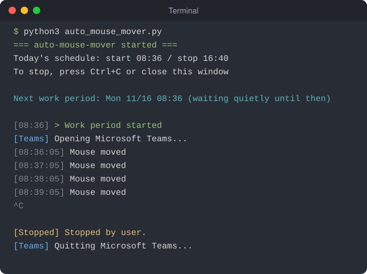

# auto-mouse-mover


[](LICENSE)
[](https://github.com/Diana-Lee0912/auto-mouse-mover/commits/main)

During the work hours you set, this script nudges the mouse 1 pixel and back once a minute, so your computer and Microsoft Teams don't switch to "Away". It opens Teams when the work period starts and quits it when the period ends.

<p align="center">
  
</p>

[中文說明在下方](#中文說明)

## Features

- **Randomized daily schedule.** You give a start range and a stop range (for example, start between 08:30 and 08:40, stop between 16:20 and 16:40). Each day the script picks a random minute inside each range, so it doesn't start at the exact same time every day.
- **Workdays only.** It runs only on the weekdays you list. Outside work hours and on days off it waits quietly and prints when the next work period begins.
- **Teams open/quit.** Teams opens at the start of the work period and quits at the end. You can turn this off.
- **Installs its own dependency.** The first time you run it, it installs [`pyautogui`](https://pypi.org/project/PyAutoGUI/) with pip, so there's nothing to set up beforehand except Python.
- **macOS and Windows.**

## Requirements

- Python 3
  - **macOS:** usually already there. If not, running `python3` in Terminal will offer to install the Command Line Developer Tools, which include it.
  - **Windows:** install it from [python.org](https://www.python.org/downloads/). On the first installer screen, tick **Add python.exe to PATH**.
- Microsoft Teams, only if you keep the Teams open/quit feature on.

## Getting started

### macOS

1. Download [`auto_mouse_mover.py`](auto_mouse_mover.py).
2. Open Terminal (press `Command + Space`, type `Terminal`, press Enter).
3. Type `python3 ` (with a space after it), drag the file into the Terminal window, and press Enter. Or run:

   ```bash
   python3 path/to/auto_mouse_mover.py
   ```

4. The first run installs `pyautogui`. This takes about a minute.
5. Give Terminal permission to control the mouse: **System Settings → Privacy & Security → Accessibility**, then switch on **Terminal**. Without this, the script runs but the mouse never moves.
6. Quit Terminal completely (`Command + Q`), open it again, and repeat step 3. The permission only takes effect after a restart of Terminal.

### Windows

1. Download [`auto_mouse_mover.py`](auto_mouse_mover.py).
2. Press the Start key, type `cmd`, and open **Command Prompt**.
3. Type `python ` (with a space after it), drag the file into the window, and press Enter. Or run:

   ```bash
   python path\to\auto_mouse_mover.py
   ```

4. The first run installs `pyautogui`. This takes about a minute.

### Stopping it

Keep the window open while you want the script to work; minimizing it is fine. To stop, press `Ctrl + C` in the window or just close it. If Teams was opened by the script, it gets quit when you stop with `Ctrl + C`.

## Settings

Open `auto_mouse_mover.py` in any text editor (TextEdit on macOS, Notepad on Windows) and change only the `SETTINGS` block at the top:

| Variable | Default | Meaning |
|---|---|---|
| `START_EARLIEST` | `"08:30"` | Earliest start time |
| `START_LATEST` | `"08:40"` | Latest start time |
| `STOP_EARLIEST` | `"16:20"` | Earliest stop time |
| `STOP_LATEST` | `"16:40"` | Latest stop time |
| `WORKDAYS` | `"Mon,Tue,Wed,Thu,Fri"` | Days to run, separated by commas. For Mon–Sat, write `"Mon,Tue,Wed,Thu,Fri,Sat"`. |
| `MOUSE_INTERVAL_SECONDS` | `60` | Seconds between mouse nudges |
| `AUTO_OPEN_CLOSE_TEAMS` | `True` | `True` opens and quits Teams automatically; `False` leaves Teams alone |

Times use the 24-hour `"HH:MM"` format. The latest start time must be earlier than the earliest stop time. If a setting is invalid, the script prints what's wrong and exits instead of running with bad values.

Save the file and run it again for changes to take effect.

## How it works

- Once a minute during work hours, the script reads the current mouse position, moves 1 pixel to the right, and moves back. You won't notice it while using the computer.
- Outside work hours it checks the clock every 60 seconds and does nothing else.
- At midnight it picks new random start and stop times for the new day.
- Teams is opened with `open -a "Microsoft Teams"` on macOS and the `msteams:` link on Windows. It's quit with AppleScript on macOS and `taskkill` on Windows.

## Notes

- **Check your employer's IT policy before using this.** Some workplaces don't allow tools like this.
- `pyautogui` blocks mouse movement while the pointer sits in a screen corner (a built-in safety feature). When that happens the script skips that nudge and carries on.
- The Windows Teams open/quit code hasn't been tested on a real Windows machine yet. If it doesn't work for you, please [open an issue](../../issues).

## License

[MIT](LICENSE)

---

## 中文說明

在你設定的上班時段內，這個程式每分鐘把滑鼠往右移 1 像素再移回原位，讓電腦和 Microsoft Teams 不會因為閒置而變成「離開」。上班時段開始時會自動開啟 Teams，結束時自動關閉。

### 功能

- **每天隨機的上下班時間**：你設定一個開始範圍和一個結束範圍（例如 08:30–08:40 之間開始、16:20–16:40 之間結束），程式每天會在範圍內各隨機挑一分鐘，不會每天都在同一時間啟動。
- **只在上班日運作**：只在你指定的星期幾執行。下班後和休假日會安靜等待，並顯示下一次上班時段什麼時候開始。
- **自動開關 Teams**：上班時段開始時開啟 Teams，結束時關閉。這個功能可以關掉。
- **自動安裝套件**：第一次執行時會用 pip 自動安裝 [`pyautogui`](https://pypi.org/project/PyAutoGUI/)，除了 Python 之外不需要事先準備任何東西。
- **支援 macOS 和 Windows**。

### 需要的環境

- Python 3（3.7 以上）
  - **macOS**：通常已經內建。如果沒有，在終端機輸入 `python3` 時會跳出視窗，詢問是否安裝「指令列開發者工具」，裡面就包含 Python。
  - **Windows**：到 [python.org](https://www.python.org/downloads/) 下載安裝。安裝程式第一個畫面最下方的 **Add python.exe to PATH** 一定要打勾。
- Microsoft Teams（只有在開啟自動開關 Teams 功能時才需要）

### 開始使用

#### macOS

1. 下載 [`auto_mouse_mover.py`](auto_mouse_mover.py)。
2. 打開「終端機」：按 `Command + 空白鍵`，輸入 `Terminal`，按 Enter。
3. 輸入 `python3 `（後面要空一格），把檔案拖進終端機視窗，按 Enter。也可以直接輸入：

   ```bash
   python3 檔案路徑/auto_mouse_mover.py
   ```

4. 第一次執行會自動安裝 `pyautogui`，大約需要 1 分鐘。
5. 讓終端機可以控制滑鼠：打開 **系統設定 → 隱私權與安全性 → 輔助使用**，把 **終端機** 打開。沒有開這個權限的話，程式會照常執行，但滑鼠完全不會動。
6. 把終端機完全關掉（`Command + Q`），重新打開，再做一次步驟 3。權限要在終端機重開之後才會生效。

#### Windows

1. 下載 [`auto_mouse_mover.py`](auto_mouse_mover.py)。
2. 按開始鍵，輸入 `cmd`，打開 **命令提示字元**。
3. 輸入 `python `（後面要空一格），把檔案拖進視窗，按 Enter。也可以直接輸入：

   ```bash
   python 檔案路徑\auto_mouse_mover.py
   ```

4. 第一次執行會自動安裝 `pyautogui`，大約需要 1 分鐘。

#### 停止程式

想讓程式運作時，視窗要保持開著（縮小沒關係）。要停止的話，在視窗裡按 `Ctrl + C`，或直接把視窗關掉。如果 Teams 是由程式開啟的，用 `Ctrl + C` 停止時會一併把 Teams 關掉。

### 設定

用任何文字編輯器（macOS 用「文字編輯」，Windows 用「記事本」）打開 `auto_mouse_mover.py`，只修改最上面 `SETTINGS` 區塊裡的值：

| 變數 | 預設值 | 說明 |
|---|---|---|
| `START_EARLIEST` | `"08:30"` | 最早開始時間 |
| `START_LATEST` | `"08:40"` | 最晚開始時間 |
| `STOP_EARLIEST` | `"16:20"` | 最早結束時間 |
| `STOP_LATEST` | `"16:40"` | 最晚結束時間 |
| `WORKDAYS` | `"Mon,Tue,Wed,Thu,Fri"` | 要運作的星期幾，用逗號分隔。`Mon` 週一、`Tue` 週二、`Wed` 週三、`Thu` 週四、`Fri` 週五、`Sat` 週六、`Sun` 週日。週一到週六就寫 `"Mon,Tue,Wed,Thu,Fri,Sat"`。 |
| `MOUSE_INTERVAL_SECONDS` | `60` | 每隔幾秒移動一次滑鼠 |
| `AUTO_OPEN_CLOSE_TEAMS` | `True` | `True` 會自動開關 Teams；`False` 則完全不動 Teams |

時間使用 24 小時制的 `"時:分"` 格式。最晚開始時間必須早於最早結束時間。如果設定填錯，程式會顯示哪裡有問題並直接結束，不會用錯誤的設定繼續跑。

改完存檔，重新執行一次就會套用新設定。

### 運作方式

- 上班時段內，程式每分鐘讀取一次目前的滑鼠位置，往右移 1 像素再移回來。你正在用電腦時幾乎感覺不到。
- 上班時段以外，程式每 60 秒看一次時間，其他什麼都不做。
- 每天午夜過後，會重新隨機挑選當天的開始和結束時間。
- 開啟 Teams：macOS 用 `open -a "Microsoft Teams"`，Windows 用 `msteams:` 連結。關閉 Teams：macOS 用 AppleScript，Windows 用 `taskkill`。

### 注意事項

- **使用前請先確認公司的 IT 規定。** 有些公司不允許使用這類工具。
- 滑鼠停在螢幕四個角落時，`pyautogui` 的安全機制會擋住滑鼠移動。遇到這種情況，程式會跳過那一次，繼續執行。
- Windows 版開關 Teams 的功能還沒有在實際的 Windows 電腦上測試過。如果無法正常運作，歡迎[開 Issue 回報](../../issues)。

### 授權

[MIT](LICENSE)
